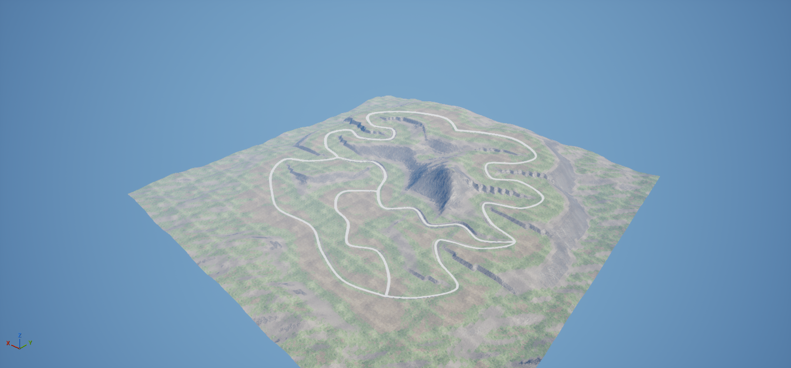

# Topografie horské oblasti a první jízdní zkouška

První návrh vytvořený 22. 10. 2026. Nejde o dokončené závody ani finální grafickou podobu.

## Otevření

V Unreal Editoru otevřít `/Game/NightshiftDrift/Maps/L_Touge_Region`.
Mapa zůstala otevřená po práci. Hlavní menu ani výchozí herní mapa projektu nebyly přepnuty na nový návrh.

## Vytvořený základ

- Nativní sochatelný **Landscape 4 032 × 4 032 metrů**, nikoli sada nízkopolygonových kopců.
- Výšková mapa 1 009 × 1 009 vzorků, vzdálenost vzorků 4 metry; 16 × 16 komponent po 63 quadech. Pro detailní krajnice bude třeba lokální dopracování.
- Výšky přibližně 28–400 metrů v lokálních souřadnicích. Jde o návrhové výšky, nikoli skutečnou geografickou oblast nebo nadmořskou výšku.
- Dvě horské oblasti, údolní propojení, severní průsmyk a jižní spojka. Koridory cest jsou zahrnuté ve tvarování svahů.
- Asfaltové pásy široké 8 metrů, krajnice, bílé okrajové a žluté středové značení; geometrie silnic má trojúhelníkovou kolizi.
- Materiál krajiny vychází z již přítomného MW Landscape Auto Material; úpravy jsou ve vlastní instanci. Asfalt využívá přítomné textury `Roads/Asphalt024A`.
- Osvětlení, atmosféra a mírný opar; PlayerStart na jižním napojení.
- Respawnová spline prochází celou sítí po skutečných navazujících cestách. Má 5 910 vzorkovaných bodů včetně opakovaných průjezdů spojkami.

| Větev silniční sítě | Přibližná délka | Největší podélný sklon návrhu |
|---|---:|---:|
| Západní průsmyk | 5 465 m | 11,59 % |
| Východní průsmyk | 7 092 m | 10,82 % |
| Údolní spojka | 2 787 m | 10,31 % |
| Jižní spojka | 1 982 m | 2,89 % |
| **Celkem různých větví** | **17 326 m** | |

Jde o délky navržených středových čar, nikoli o ověřené časy závodů. Ve složce Outlineru `05_PlannedEvents` jsou pouze organizační značky pěti zamýšlených událostí. Závodní logika tím nebyla implementována.

## Ověření mapy

- Mapa se úspěšně uložila a znovu načetla bez pádu.
- Po načtení je přítomný jeden nativní Landscape a respawnová spline stále obsahuje 5 910 bodů.
- Svislá kolizní sonda v místě startu zasáhla silnici ve výšce 6 500 cm; vzdálenost zásahu ze 100 000 cm byla 93 500 cm.
- Při tvorbě byly opraveny obrácené orientace trojúhelníků importovaných silnic. Finální kolize byla ověřena sondou i vozem.

## Metoda jízdní zkoušky

V PIE byl použit skutečný `BP_DriftCar`, současná fyzika a běžné Enhanced Input akce. Pomocný skript řídil plyn, natočení, brzdu a ruční brzdu. Vůz začínal na první rychlost v jižní spojce. Test měl 27 sekund herního času a zaznamenal 267 vzorků.

Editor měl po dobu závěrečného testu vypnuté zpomalování simulace na pozadí; po testu byly obě původní volby obnoveny. Dřívější pokusy nebyly použity pro výsledné závěry: první nevhodně držel brzdu ve stání (aktivoval zpátečku), další běžel s omezeným tickováním na pozadí. Tato měření nejsou vydávána za chybu vozidlové fyziky.

Tato zkouška ověřuje základní reakce, nikoli subjektivní pocit hráče nebo průjezdnost celé mapy.

## Naměřené výsledky závěrečného testu

| Zkouška | Pozorovaný výsledek |
|---|---|
| První rozjezd, přibližně 6 s | 0 → 45,6 km/h |
| Následné sledování zatáčky | Rychlost přibližně 40–46 km/h |
| Brzdění | Z přibližně 40,4 km/h pod 1 km/h za 2,81 s na přibližně 12,11 m; v brzdné fázi dosáhl vůz 0 km/h |
| Druhý rozjezd | Maximálně přibližně 49,1 km/h |
| Ruční brzda s natočením | Rychlost přibližně 48,5 → 33,5 km/h; maximální úhel smyku přibližně 29° |
| Náklon | Největší absolutní náklon kolem podélné osy 4,27° |
| Následné srovnávání | Testovací řízení vyjelo mimo asfalt; vzdálenost od nejbližšího vzorku středové čáry dosáhla 9,85 m |

Vůz se během zaznamenané zkoušky nepřevrátil ani nepropadl terénem. Sledování trasy není dokonalý autopilot: i při rozjezdu dosáhla vzdálenost od nejbližšího vzorku přibližně 4,47 m. Údaj zahrnuje také vzdálenost podél čtyřmetrového vzorkování; nejde o přesně vypočtenou kolmou odchylku od spojité středové čáry.

Při dodatečné ruční aktivaci respawnu byl vůz přesunut mimo silniční síť na `[0, -180000, 8000]` cm a `RespawnNow(true)` jej vrátil k bezpečnému bodu na síti přibližně `[-85105, -110899, 7005]` cm. Automatický návrat po časovém limitu mimo trať nebyl tímto krokem samostatně ověřen.

[Úplná naměřená data](tests/vehicle-probe-2026-10-22.json) umožňují ověřit závěry. Hodnoty nejsou homologovaným měřením skutečného automobilu ani výkonovým benchmarkem.

## Co zbývá

- Ručně ověřit všechny serpentiny, křižovatky, krajnice a převýšení; upravit ostrá napojení cest.
- Doladit chování a srovnávání driftu s hráčem. Samotný automatický test neprokazuje potřebu konkrétní změny asistencí.
- Ověřit automatický respawn, přechody mezi větvemi a opakované načtení během hry.
- Doplnit svodidla, opěrné zdi, detaily zářezů a okolní horizont.
- Přidat řízené PCG stromy a vegetaci s vyloučením vozovky. Původní procedurální vegetační přepínače materiálu byly ve vlastní instanci vypnuty; PCG les ještě není vytvořen.
- Ověřit materiály z jízdní vzdálenosti a zoptimalizovat prostředí na cílovém počítači.
- Implementovat skutečné závodní události a propojit novou mapu s menu až po ověření průběhu hry.

V této etapě nebyl přepsán C++ model auta. Praktická změna pro vozidlo spočívá v připravených kolizích, PlayerStartu a napojení existujícího respawnu na novou mapu.

## Zdrojové podklady a opakování

- `Tools/Terrain/generate_region.py`: reprodukovatelná tvorba výškové mapy a návrhových cest, bez externích Python závislostí.
- `SourceArt/Terrain/region.r16`: zdroj nativního terénu, verzovaný přes Git LFS.
- `SourceArt/Terrain/region_manifest.json`: měřítko, délky, sklony a středové čáry.
- `Tools/Terrain/setup_region.py`: základní nastavení mapy po importu terénu, spouští se v Unreal Python.
- `Tools/Terrain/build_roads.py`: tvorba a import silničních pásů a materiálů v Unreal Python.
- `Tools/Terrain/setup_respawn.py`: návazná spline pro současný respawn.
- `Tools/Terrain/test_vehicle_pie.py`: měřená zkouška v běžícím PIE; jde o Unreal skript, nikoli běžný pytest test.

Import Landscape: 1 009 × 1 009, 63 quadů na sekci, jedna sekce na komponentu, 16 × 16 komponent, měřítko `[400,400,300]`. Po importu ověřit skutečný počátek Landscape `[-201600,-201600,0]` cm; importovací dialog může polohu centrovat. Změny zdroje vyžadují opětovný import výškové mapy, nikoli jen znovuspuštění skriptu pro materiál.
